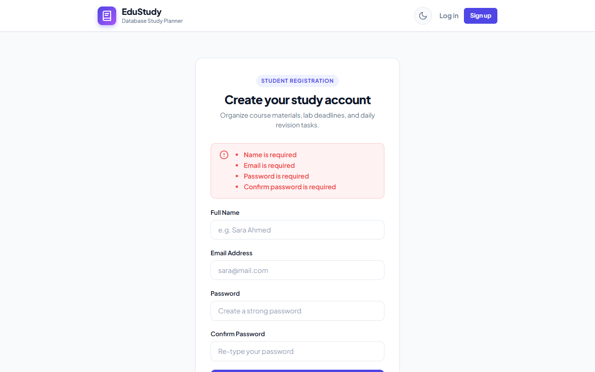
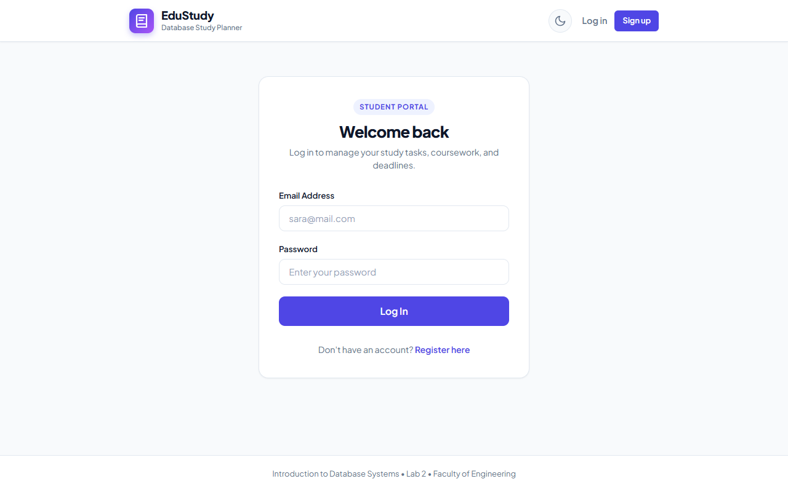
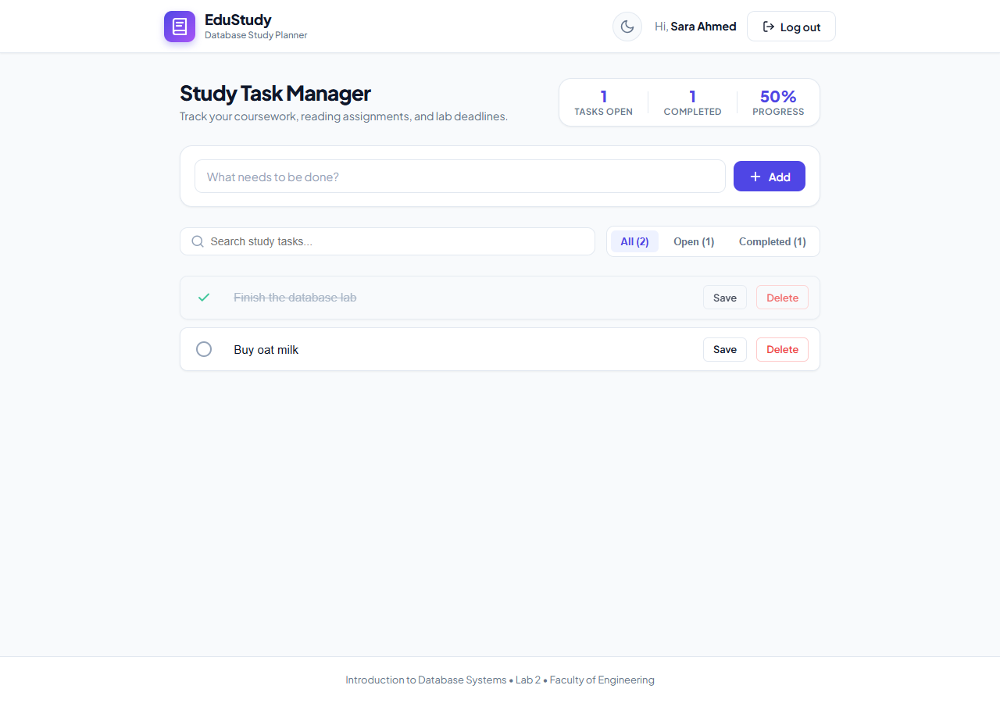
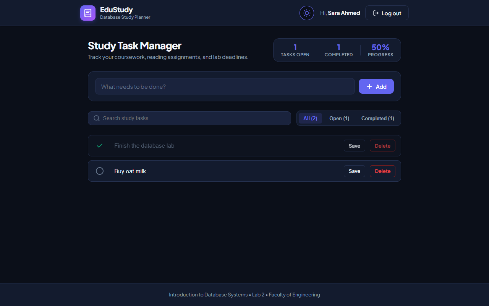

# Student Study Database System (EduStudy)
### Alexandria National University — Faculty of Engineering
**Introduction to Database Systems — Lab 2 (Fall 2026)**  


---

## 1. Team Members & Contributions

| Member Name | Student ID | Role / Contributions |
|-------------|------------|-----------------------|
| **Ahmed Hatem** | *[2304158]* | Backend API architecture (Node.js/Express), MySQL relational schema design, password security (bcrypt), input validation, session management, frontend UI/UX, responsive styling, and automated test suite. |


---

## 2. Technology Stack

- **Back End:** Node.js, Express.js (`v4.21.2`)
- **Authentication & Security:** `bcryptjs` (salted cryptographic hashing with 12 rounds), `express-session` (cookie-based server-side session management)
- **Database Driver:** `mysql2` with parameterized SQL queries (`?` placeholders) and connection pooling. **No ORM is used** (plain SQL as strictly mandated).
- **Front End:** Modern HTML5, Semantic CSS3 (Flexbox, CSS Grid, CSS Custom Properties for theming), Vanilla JavaScript for client-side validation and dynamic filters.
- **Templating Engine:** EJS (Embedded JavaScript)
- **Database:** MySQL Server 8.0 (`database: registration`)

---

## 3. How to Run from an Empty Machine (Step-by-Step)

Follow these steps to run the application on any clean machine:

### Step 1: Clone the Repository
```bash
git clone <repository-url>
cd db-lab2-study-system
```

### Step 2: Install Dependencies
Ensure [Node.js](https://nodejs.org/) (v18 or higher) and [MySQL Server](https://dev.mysql.com/downloads/mysql/) are installed.
```bash
npm install
```

### Step 3: Run the Database DDL Script
Open your MySQL client / terminal or MySQL Workbench, and execute the SQL file:
```bash
mysql -u root -p < database/schema.sql
```
*Note: `schema.sql` begins with `DROP DATABASE IF EXISTS registration; CREATE DATABASE registration; USE registration;`, making it completely re-runnable without errors.*

### Step 4: Configure Environment Variables
Copy `.env.example` to `.env`:
```bash
# On Windows PowerShell:
Copy-Item .env.example .env

Open `.env` and set your MySQL password:
```env
PORT=3000
SESSION_SECRET=super_secret_student_study_session_key_2026

DB_HOST=localhost
DB_PORT=3306
DB_USER=root
DB_PASSWORD=your_actual_mysql_password
DB_NAME=registration
```

### Step 5: Start the Server
```bash
npm start
```
*For active development with auto-reload:*
```bash
npm run dev
```

### Step 6: Open the Application
Navigate in your web browser to:
```
http://localhost:3000
```

### Step 7: Run Automated Tests
```bash
npm test
```

---

## 4. Features Implemented (R1–R10 & Bonus)

| Feature | Description |
|---------|-------------|
| **R1 — Student Registration** | Register with `name`, `email`, `password`, `confirm_password`. Hashes passwords with bcrypt. Prevents duplicate registrations with `"Email Already Exists"`. Automatically logs student in upon successful registration. |
| **R2 — Student Login & Logout** | Authenticates credentials against MySQL using bcrypt. Shows unified error message `"Invalid email or password"` on invalid email or wrong password. Secure logout destroys server session and clears cookie. |
| **R3 — Privacy & Access Control** | Unauthenticated visitors attempting to view `/` are immediately redirected to `/login`. Each student only accesses their own tasks (`WHERE user_id = ? ORDER BY todo_id DESC`). |
| **R4 — Add Study Task** | Add new study task/to-do with title (`INSERT INTO todos (user_id, title) VALUES (?, ?)`). |
| **R5 — Edit Task Title** | Update study task title inline (`UPDATE todos SET title = ? WHERE todo_id = ? AND user_id = ?`). |
| **R6 — Toggle Status (Done / Open)** | Mark task completed or open with visual feedback (`UPDATE todos SET is_done = ? WHERE todo_id = ? AND user_id = ?`). |
| **R7 — Delete Task** | Deletes study task with interactive `"Are you sure?"` confirmation dialog (`DELETE FROM todos WHERE todo_id = ? AND user_id = ?`). |
| **R8 — Dual-Layer Validation** | Client-side JavaScript + server-side validation enforcing identical rules: `"Name is required"`, `"Email is required"`, `"Password is required"`, `"Confirm password is required"`, `"Passwords do not match"`, `"Title is required"`, `"Title is too long"`. If server detects an error, it re-renders the page with error messages without touching MySQL. |
| **R9 — Security & Parameterization** | Cryptographic salted bcrypt hashing (12 rounds). Zero string concatenation in SQL—all queries use `?` placeholders. User ID strictly read from server session, never trusted from client forms. |
| **R10 — Responsive & Polished UI** | High-contrast, clean academic aesthetic with modern layout. Clear alert banners, strikethrough for completed tasks, friendly empty states, user greeting, and logout controls. No raw errors or stack traces. |
| **BONUS 1: Study Progress & Task Counters** | Live counters for Open Tasks, Completed Tasks, and overall Study Completion Percentage. |
| **BONUS 2: Task Filtering** | Filter pills: **All**, **In Progress (Open)**, and **Completed**. |
| **BONUS 3: Real-Time Search Box** | Instant live search filtering study tasks by keyword. |
| **BONUS 4: Dark Mode / Light Mode** | Integrated theme toggle button with `localStorage` persistence. |
| **BONUS 5: Automated Test Suite** | Native Node.js unit and integration tests (`npm test`) validating bcrypt hashing, all validation constraints, and multi-tenant query isolation. |

---

## 5. Application Screenshots

### 1. Register Page with Validation Errors


### 2. Login Page


### 3. Study Task Manager Dashboard (Light Mode)


### 4. Study Task Manager Dashboard (PC Vision — Dark Mode)


